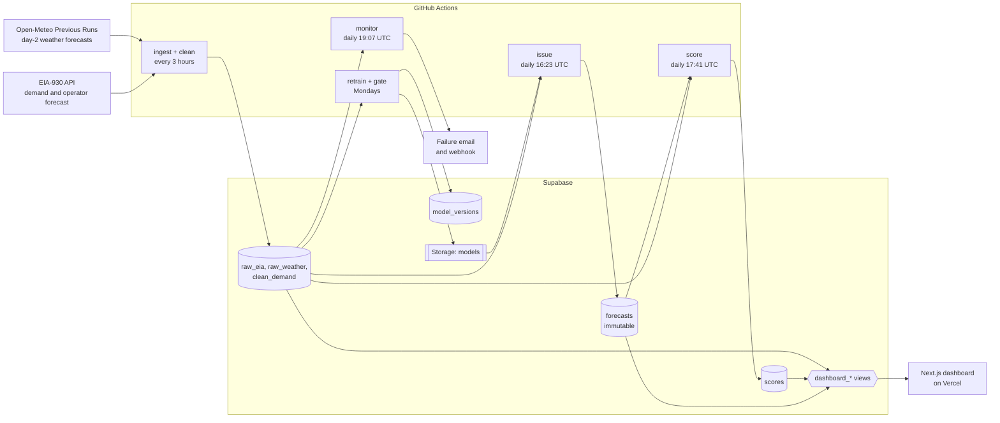

# Live grid demand forecaster

A live, day-ahead electricity demand forecaster for the California ISO (EIA balancing authority `CISO`). Every morning it forecasts each hour of the next day, records the forecast so that it cannot be changed, and later scores it against actual demand and against the grid operator's own published day-ahead forecast.

Live forecasts have been issued daily since 2026-10-12. The design brief is in [CLAUDE.md](CLAUDE.md) and the milestone-by-milestone log, with every number below, is in [docs/progress.md](docs/progress.md).

## Results

Backtest over 2025-10 to 2026-09: 8,710 scored hours, retrained at the start of each month on everything before it, each day forecast exactly as the live system would.

| | MAPE, all hours | MAPE outside 09:00-17:00 | MAE | Daily peak error |
|---|---|---|---|---|
| Seasonal naive (same hour last week) | 6.68% | 5.82% | 1,873 MW | 2,472 MW |
| LightGBM: calendar and demand lags | 4.59% | 3.95% | 1,293 MW | 1,697 MW |
| LightGBM: plus temperature forecasts | 3.43% | 2.78% | 944 MW | 1,171 MW |
| LightGBM: full (plus solar, cloud, wind, rain) | 3.40% | 2.73% | 939 MW | 1,151 MW |
| Operator's day-ahead forecast | 8.97% | 3.55% | 2,454 MW | 879 MW |

How to read it:

- The full model halves the error of the seasonal-naive baseline. Temperature forecasts account for almost all of the gain over calendar and lags.
- The fair comparison with the operator is the column for hours outside 09:00-17:00 Pacific: 2.73% against 3.55%. Since 2023 the operator's published forecast and its reported demand have diverged in the middle of the day (by about 7 GW on average in 2026), so in those hours the two no longer measure the same quantity. The operator's 8.97% all-hours figure reflects that mismatch, not its forecasting skill. The mismatch is present in CAISO's own published series, not introduced by EIA; its cause is not established here.
- The operator is better at the daily peak.
- These are backtest numbers on demand as later revised. The live record is the real test, and it is short so far.

## How it works



- **Ingest** re-pulls the trailing seven days on every run, because EIA revises its data, and upserts. **Clean** screens reported demand for gaps, spikes, stuck values and outliers.
- **Issue** builds tomorrow's inputs through the same function the backtest uses, forecasts with the active model, and inserts the rows.
- **Score** scores each day once, 72 hours after it ends, on the hours where the actual passed screening and the operator published a forecast.
- **Retrain** trains a candidate, judges a copy of it on the last 28 settled days against what was actually issued, and promotes it only if it holds up.
- **Monitor** checks that tomorrow's forecast exists, that demand and weather inputs are complete, and that the live error has not drifted to more than 1.5 times the backtest error.

## The rules that keep it honest

1. **No look-ahead.** A forecast issued on day D for day D+1 uses demand only through the end of day D-1. `build_inputs` is the single place where data is cut off, and both the backtest and the live job go through it. Tests replace everything after the cutoff with absurd values and assert that inputs, training and forecasts do not change.
2. **Weather inputs are forecasts, never observations.** Only archived forecasts made at least two days before the hour they describe, from one pinned model (`gfs_global`). The client refuses a shorter lead.
3. **Screening cannot leak either.** Demand is screened as of each issue time, so a flag or a filled-in value never depends on later data. Flagged hours are filled in for model inputs and are never scored or learned from.
4. **Forecasts are immutable.** The database stamps the issue time from its own clock, rejects a forecast for an hour that has already started, and rejects UPDATE, DELETE and TRUNCATE. The first forecast recorded for a day stands, whichever model made it.
5. **Time-based evaluation only.** Rolling-origin backtest with an expanding window. Hyperparameters are fixed defaults; the one modeling choice that was tested was decided on data before the backtest window.
6. **The operator's forecast is never a model input.** It is only scored.
7. **Same hours for everyone.** An hour missing from any forecast is skipped for all of them.

## Limitations

- **The target and the operator's forecast are not the same quantity at midday.** See Results. The head-to-head is reported outside 09:00-17:00, and a day on which the operator publishes no forecast (around daylight-saving changes) is not scored.
- **Backtests see revised demand.** No revision history is kept, so a backtest uses final values where a live forecast saw preliminary ones.
- **The live job does not record the feature values it used**, so differences between live and backtest inputs cannot be measured afterwards.
- **A missed day stays missed.** If the issue job fails, that day is absent from the record.
- **Weather timing.** The day-2 forecast for the last hours of the target day comes from the 06:00 UTC model run. If that run is published late, those hours use an older run than a later backtest would.
- **Short weather history.** Day-2 forecasts are archived only from 2024-01-20, so the model has seen under three years.
- **Untuned.** Default LightGBM hyperparameters, point forecasts only, one system-wide model.
- **Six weather points with equal weights**, not weighted by where load is.

## Setup

Requires [uv](https://docs.astral.sh/uv/) (it installs Python 3.12 itself), Docker for the local database, and Node 24 for the dashboard.

```sh
uv sync
cp .env.example .env    # add your EIA API key; DATABASE_URL defaults to the local database
docker compose up -d    # local Postgres on localhost:54322
```

A free EIA key is available at https://www.eia.gov/opendata/register.php. Jobs use `DATABASE_URL` from `.env`, so they write to whichever database it points at.

## Commands

```sh
uv run python -m gridcast.jobs.ingest --backfill  # load EIA from 2019-01 and weather from 2024-01-20
uv run python -m gridcast.jobs.ingest             # re-pull the trailing 7 days
uv run python -m gridcast.jobs.clean              # screen reported demand
uv run python -m gridcast.jobs.backtest [--save]  # 12-month backtest; --save stores it for the dashboard
uv run python -m gridcast.jobs.retrain            # train a candidate and promote it if it passes the gate
uv run python -m gridcast.jobs.issue --dry-run    # forecast tomorrow without recording it
uv run python -m gridcast.jobs.issue              # forecast tomorrow and record it (immutable)
uv run python -m gridcast.jobs.score              # score forecast days that ended 72+ hours ago
uv run python -m gridcast.jobs.monitor            # health checks; exits non-zero on a failure
uv run pytest                                     # fixtures plus the local database; never the network
uv run ruff check . && uv run ruff format --check .
```

Every job applies pending migrations from `sql/migrations/` and is safe to repeat.

## Scheduled jobs

GitHub Actions needs these repository secrets: `EIA_API_KEY`, `DATABASE_URL`, `SUPABASE_URL`, `SUPABASE_SERVICE_ROLE_KEY`, and optionally `ALERT_WEBHOOK_URL` (a Slack or Discord incoming webhook). Without the webhook, GitHub's failure email is the only alert.

| Workflow | Schedule (UTC) |
|---|---|
| `ingest.yml` | every 3 hours at :17 |
| `issue.yml` | daily 16:23 (09:23 PDT / 08:23 PST), with backup runs at 17:53, 19:23 and 21:53 |
| `score.yml` | daily 17:41 |
| `monitor.yml` | daily 19:07 and 23:07 |
| `retrain.yml` | Mondays 12:47 |

GitHub can delay or drop scheduled runs, which is why the issue job has backup slots: the first forecast recorded for a day stands, so the extra runs are harmless. GitHub also disables scheduled workflows in a public repository after 60 days without repository activity.

### Outside scheduler (optional)

If GitHub's scheduler proves unreliable, Supabase can trigger the same workflows itself: `pg_cron` calls GitHub's workflow-dispatch API on the same timetable. The workflows' own schedules stay in place as a backup, and every job is safe to run twice.

1. Create a fine-grained GitHub token limited to this repository, with the single permission "Actions: Read and write".
2. Put it in `.env` as `GITHUB_DISPATCH_TOKEN`.
3. Run `uv run python -m gridcast.jobs.scheduler install`. This stores the token in Supabase Vault and creates the cron jobs. Remove the token from `.env` afterwards.

`uv run python -m gridcast.jobs.scheduler status` lists the jobs and GitHub's recent responses, and `remove` undoes the installation. The monitor reports any call GitHub refused, which is what an expired token looks like.

## Dashboard

`web/` is a Next.js app that reads only the `dashboard_*` views with Supabase's publishable key. The tables themselves are closed to that key.

```sh
cd web
cp .env.example .env.local   # set NEXT_PUBLIC_SUPABASE_URL and NEXT_PUBLIC_SUPABASE_ANON_KEY
npm install
npm run dev
```

To deploy on Vercel, import the repository, set the root directory to `web`, and add the same two environment variables.

## Layout

```
src/gridcast/
  config.py  db.py  protocol.py  scoring.py  alerts.py
  ingest/     EIA and Open-Meteo clients
  clean/      screening and imputation
  features/   build_inputs and feature_frame, shared by backtest and live
  models/     seasonal naive, LightGBM, registry
  backtest/   rolling-origin harness
  jobs/       ingest, clean, backtest, retrain, issue, score, monitor
sql/migrations/   schema, applied in order
tests/            181 tests on recorded fixtures and a local database
notebooks/        cleaning EDA
web/              dashboard
docs/progress.md  what changed at each milestone, with numbers
```
